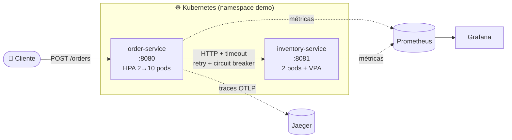

# 🏗️ Arquitetura de Sistemas Distribuídos com Java + Spring

Projeto de estudo (Unidade 3 – Atividade 5) com **dois microsserviços Spring Boot** e uma documentação visual (Mermaid) sobre:

| Tema | Onde ver |
|---|---|
| 📦 Containers | [docs/01-containers.md](docs/01-containers.md) · `Dockerfile`, `docker-compose.yml` |
| ☸️ Kubernetes | [docs/02-kubernetes.md](docs/02-kubernetes.md) · `k8s/` |
| 📈 Escala vertical e horizontal | [docs/03-escalabilidade.md](docs/03-escalabilidade.md) · `k8s/20-order.yaml`, `k8s/30-vpa-example.yaml` |
| 🔭 Observabilidade | [docs/04-observabilidade.md](docs/04-observabilidade.md) · `observability/` |
| ⚖️ Trade-offs (CAP, consistência, resiliência) | [docs/05-tradeoffs.md](docs/05-tradeoffs.md) · `InventoryClient`, `OrderService` |

## 🧩 Visão geral



### Serviços

| Serviço | Responsabilidade | Endpoints principais |
|---|---|---|
| `order-service` | Cria pedidos e consulta o estoque remotamente | `POST /orders` (header `Idempotency-Key`), `GET /orders/{id}`, `GET /whoami`, `GET /load/cpu?millis=` |
| `inventory-service` | Informa o estoque (`BOOK-1`=100, `BOOK-2`=5, `BOOK-3`=0) | `GET /inventory/{sku}`, `POST /chaos?latencyMs=&failurePercent=`, `GET /load/cpu` |

Ambos expõem `/actuator/health/{liveness,readiness}` e `/actuator/prometheus`.

## 🚀 Como executar

Pré-requisitos: JDK 21+, Maven 3.9+, Docker (e, opcionalmente, `kind`/`minikube` + `kubectl`).

### 1. Local (sem containers)

```bash
mvn verify
java -jar inventory-service/target/inventory-service-1.0.0.jar &
java -jar order-service/target/order-service-1.0.0.jar &

curl -XPOST localhost:8080/orders -H 'content-type: application/json' \
     -d '{"sku":"BOOK-1","quantity":2}'
```

### 2. Docker Compose (app + Prometheus + Grafana + Jaeger)

```bash
docker compose up --build
```

| UI | URL |
|---|---|
| order-service | http://localhost:8080 |
| Prometheus | http://localhost:9090 |
| Grafana (admin/admin) | http://localhost:3000 |
| Jaeger | http://localhost:16686 |

### 3. Kubernetes (kind/minikube)

```bash
docker build --build-arg MODULE=order-service     -t order-service:1.0.0 .
docker build --build-arg MODULE=inventory-service -t inventory-service:1.0.0 .
kind load docker-image order-service:1.0.0 inventory-service:1.0.0   # minikube: minikube image load ...

kubectl apply -f k8s/00-namespace.yaml -f k8s/10-inventory.yaml -f k8s/20-order.yaml -f k8s/40-jaeger.yaml
# O HPA precisa do metrics-server (minikube addons enable metrics-server)
kubectl -n demo port-forward svc/order-service 8080:80
scripts/load.sh http://localhost:8080 8 180 &
kubectl -n demo get hpa -w
```

## 🧪 Experimentos sugeridos

| Experimento | Comando | O que observar |
|---|---|---|
| Falha do downstream | `curl -XPOST 'localhost:8081/chaos?failurePercent=100'` e crie pedidos | Pedidos viram `202 PENDING_VALIDATION`; o circuito abre (`/actuator/circuitbreakers`) |
| Latência alta | `curl -XPOST 'localhost:8081/chaos?latencyMs=2000'` | Timeout de 800 ms + retries; p99 sobe no Grafana |
| Idempotência | Repita o POST com o mesmo `Idempotency-Key` | Mesmo `id`, sem nova consulta ao estoque |
| Escala horizontal | `scripts/load.sh` | HPA cria pods; `GET /whoami` mostra pods diferentes |
| Rolling update | `kubectl -n demo rollout restart deploy/order-service` | Sem erros: readiness + `maxUnavailable: 0` + graceful shutdown |

> ℹ️ Build, testes e o fluxo de falha/circuit breaker foram validados localmente com Maven. O `Dockerfile`, o compose e os manifestos Kubernetes não foram executados no ambiente de criação.
