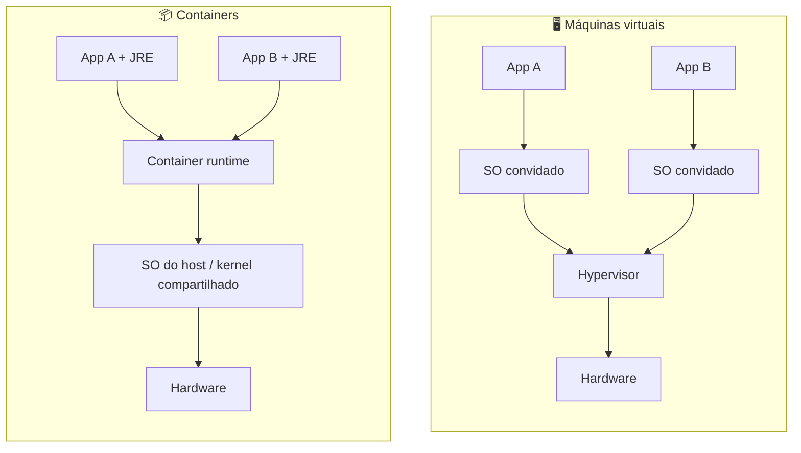

# 📦 Containers

Um **container** empacota a aplicação + dependências (JRE, libs) e roda isolado usando recursos do kernel Linux (*namespaces* para isolamento, *cgroups* para limitar CPU/memória). Diferente de uma VM, **compartilha o kernel do host**: inicia em segundos e é mais leve.

## Build multi-stage deste projeto

Boas práticas aplicadas no [`Dockerfile`](../Dockerfile):

| Prática | Por quê |
|---|---|
| Multi-stage | Imagem final sem Maven/JDK: menor e com menos superfície de ataque |
| Camada de dependências antes do código (`dependency:go-offline`) | Cache de build: só reconstrói o que mudou |
| Usuário não-root (`USER 10001`) | Limita o dano em caso de comprometimento |
| `-XX:MaxRAMPercentage=75` | A JVM dimensiona o heap pelo **limite do container**, não pela memória do host |
| `-XX:+ExitOnOutOfMemoryError` | Em OOM o processo morre e o orquestrador reinicia (melhor que ficar meio-quebrado) |
| Graceful shutdown (`server.shutdown=graceful`) | Termina requisições em andamento ao receber SIGTERM |
| Config por variável de ambiente (`INVENTORY_URL`) | Mesma imagem em todos os ambientes (12-factor) |

## ⚖️ Trade-offs

| Ganho | Custo |
|---|---|
| Ambiente reproduzível ("funciona na minha máquina" some) | Mais uma camada para operar e depurar |
| Densidade e partida rápida | Isolamento mais fraco que VM (kernel compartilhado) |
| Base para orquestração | Estado dentro do container é efêmero: use volumes/bancos externos |
| Jar Spring tem *cold start* de segundos | Alternativas: CDS/AOT, GraalVM native (build mais lento, menos dinâmico) |
