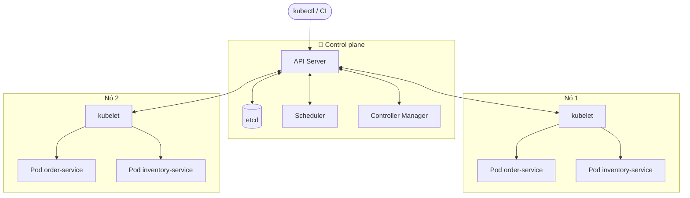
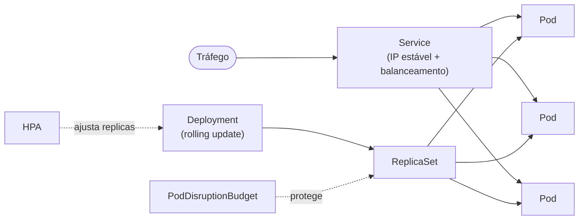
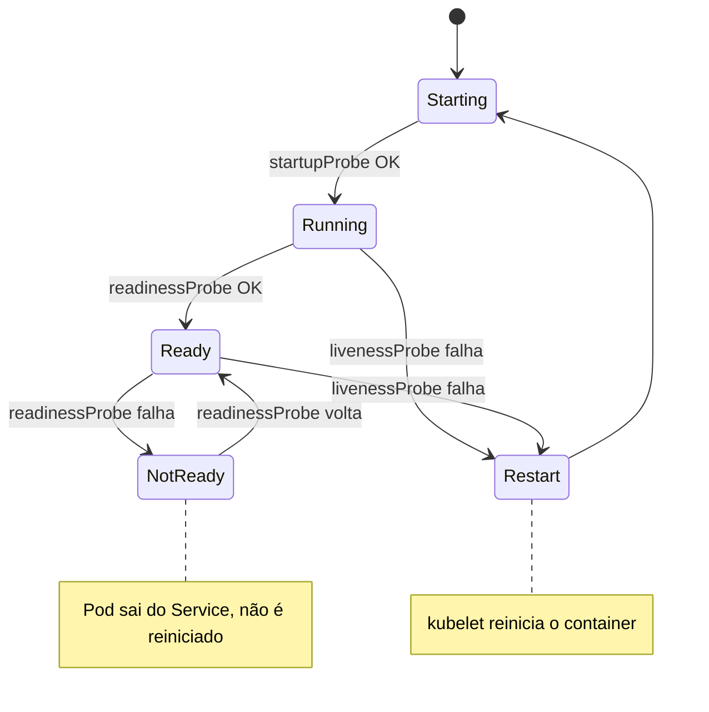
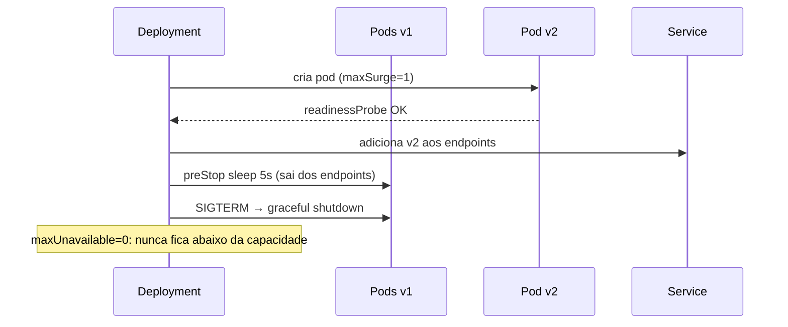

# ☸️ Kubernetes

Kubernetes é um **orquestrador**: você declara o *estado desejado* (ex.: "2 réplicas desta imagem") e controladores trabalham continuamente para convergir o estado real a ele.

## Arquitetura

## Objetos usados no projeto

| Objeto | Arquivo | Função |
|---|---|---|
| Deployment | `k8s/10-inventory.yaml`, `k8s/20-order.yaml` | Mantém N réplicas e faz rolling update |
| Service | idem | DNS estável (`inventory-service`) + balanceamento entre pods prontos |
| HPA / VPA | `20-order.yaml`, `30-vpa-example.yaml` | Escala automática (ver [escalabilidade](03-escalabilidade.md)) |
| PodDisruptionBudget | `20-order.yaml` | Garante mínimo de pods durante manutenção de nós |

## Probes: como o K8s sabe se a app está saudável

Spring Boot expõe `/actuator/health/liveness` e `/readiness` (`management.endpoint.health.probes.enabled=true`).

## Deploy sem downtime

## ⚖️ Trade-offs

| Ganho | Custo |
|---|---|
| Auto-recuperação, rolling updates, escala declarativa | Complexidade operacional e curva de aprendizado |
| Portabilidade entre clouds | Custo do control plane, rede (CNI), segurança e RBAC para gerir |
| Service discovery embutido | Para poucos serviços, Compose/PaaS pode ser mais simples |
