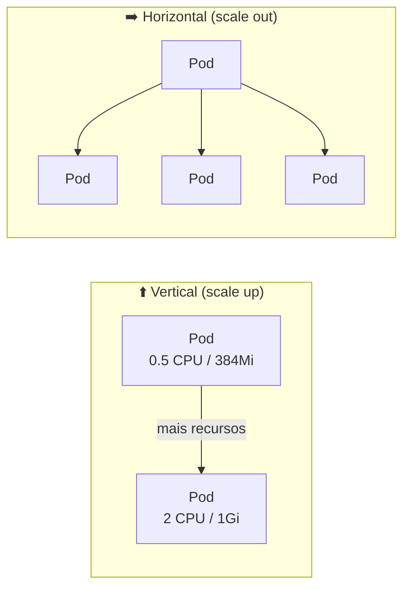
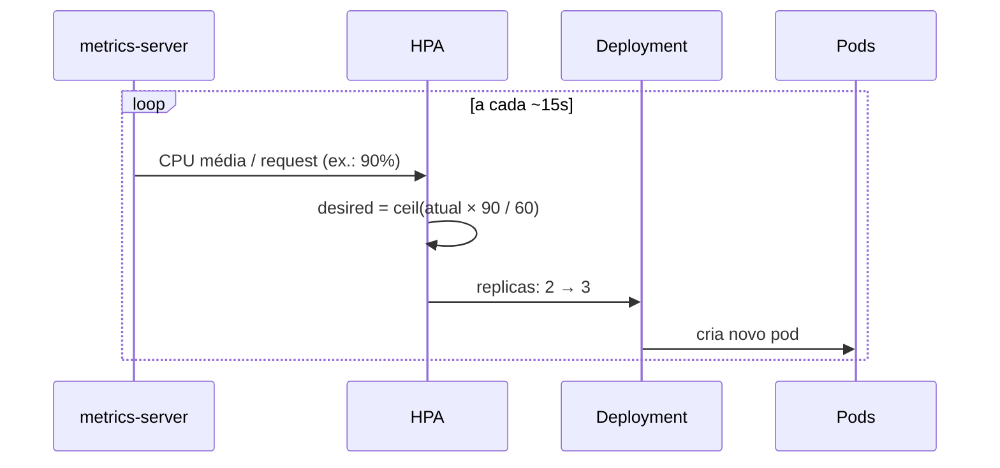
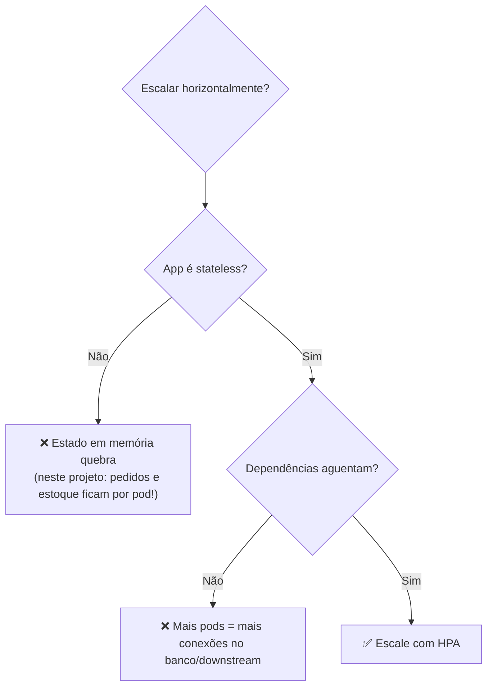
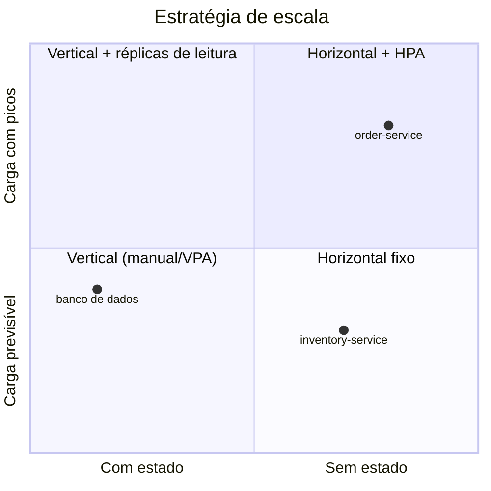

# 📈 Escala vertical vs. horizontal

| | ⬆️ Vertical | ➡️ Horizontal |
|---|---|---|
| O que muda | CPU/memória por instância | Número de instâncias |
| No projeto | `resources.limits` / VPA (`k8s/30-vpa-example.yaml`) | HPA (`k8s/20-order.yaml`), `replicas` |
| Limite | Tamanho máximo do nó; ponto único de falha | Praticamente ilimitado, exige app sem estado |
| Disponibilidade | Pode exigir reinício do pod ao redimensionar | Mais réplicas = tolerância a falhas |
| Complexidade na app | Baixa | Alta: estado, sessão, consistência, balanceamento |
| Bom para | Bancos de dados, workloads com estado, JVM com heap grande | APIs *stateless*, picos de tráfego |

## Escala horizontal com HPA

Fórmula: `réplicas desejadas = ceil(réplicas atuais × métrica atual / métrica alvo)`.
Com alvo de 60 % de CPU e 2 pods a 90 %: `ceil(2 × 90/60) = 3`.

> ⚠️ A CPU é medida **em relação ao `request`**. Sem `requests.cpu` o HPA não funciona.

### Armadilhas

- **Estado em memória**: `OrderService` guarda pedidos num `ConcurrentHashMap`. Com 2+ pods, `GET /orders/{id}` pode cair em outro pod e dar 404. Em produção: banco/cache compartilhado. *(Intencional, para demonstrar o problema.)*
- **Startup lento da JVM**: novos pods demoram a ficar prontos; mantenha folga (`minReplicas`, alvo de CPU ≤ 60 %).
- **Flapping**: `behavior.scaleDown.stabilizationWindowSeconds` suaviza.
- **HPA + VPA** no mesmo recurso (CPU/memória) conflitam; use VPA em modo `Off` para só obter recomendações.

## Escala vertical na JVM

1. Aumente `limits.memory`; `MaxRAMPercentage=75` ajusta o heap automaticamente.
2. Aumente `limits.cpu`: GC e threads do Tomcat passam a usar mais núcleos.
3. Limite de CPU muito baixo causa *throttling* (latência alta mesmo com CPU "livre"). Observe `container_cpu_cfs_throttled_seconds_total`.

## ⚖️ Como escolher

