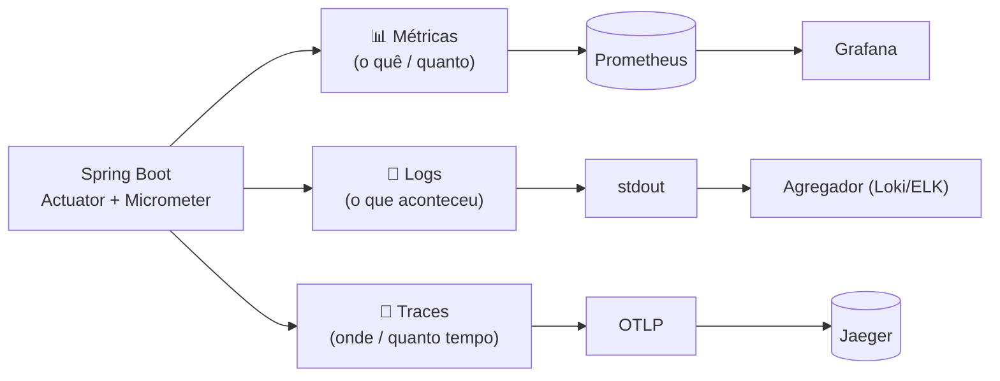
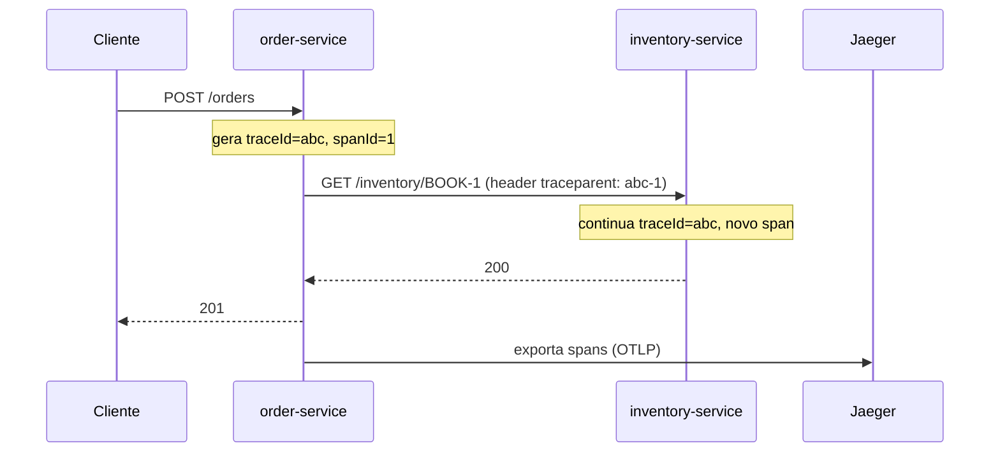
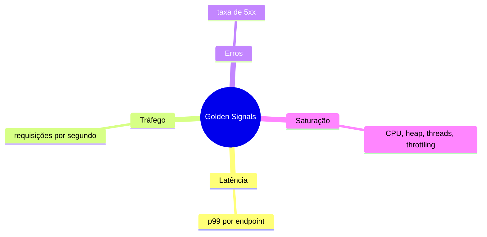
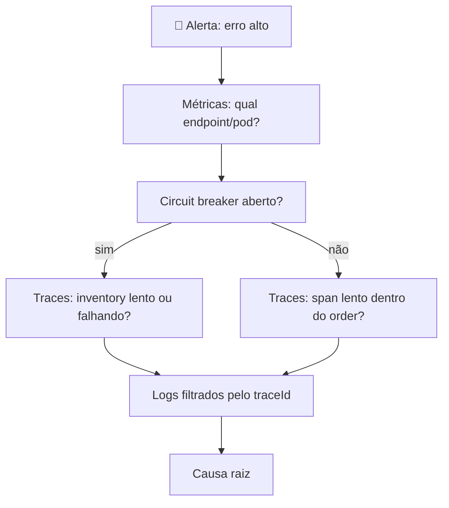

# 🔭 Observabilidade

> Monitoramento responde "**está quebrado?**"; observabilidade ajuda a responder "**por que** está quebrado?" sem precisar de novo deploy.

## Os 3 pilares

| Pilar | Implementação no projeto |
|---|---|
| Métricas | `micrometer-registry-prometheus` → `/actuator/prometheus`; métrica de negócio `orders_created_total{status}`; métricas do Resilience4j |
| Logs | Padrão com `[app,traceId,spanId]` (`application.yml`): cada linha liga ao trace |
| Traces | `micrometer-tracing-bridge-otel` + OTLP → Jaeger; `RestClient.Builder` propaga o contexto (`traceparent`) para o inventory |
| Health | `/actuator/health/liveness` e `/readiness` (usados pelas probes do K8s) |

## Fluxo de um trace

> O `inventory-service` é deliberadamente simples (só métricas). Para ver o span dele no Jaeger, adicione as mesmas dependências de tracing do `order-service`.

## Golden Signals e como consultá-los (PromQL)

| Sinal | PromQL |
|---|---|
| Tráfego | `sum(rate(http_server_requests_seconds_count{application="order-service"}[1m]))` |
| Erros | `sum(rate(http_server_requests_seconds_count{status=~"5.."}[5m])) / sum(rate(http_server_requests_seconds_count[5m]))` |
| Latência p99 | `histogram_quantile(0.99, sum by (le) (rate(http_server_requests_seconds_bucket{application="order-service"}[5m])))` |
| Saturação (heap) | `jvm_memory_used_bytes{area="heap"} / jvm_memory_max_bytes{area="heap"}` |
| Circuito aberto | `resilience4j_circuitbreaker_state{name="inventory",state="open"} == 1` |
| Pedidos por status | `sum by (status) (rate(orders_created_total[1m]))` |

Alertas de exemplo em [`observability/alerts.yml`](../observability/alerts.yml).

## Roteiro de investigação

## ⚖️ Trade-offs

| Decisão | Ganho | Custo |
|---|---|---|
| Amostragem de 100 % dos traces (`TRACING_SAMPLING=1.0`) | Visibilidade total | Custo/overhead alto; em produção use 1–10 % ou *tail sampling* |
| Muitas labels em métricas (ex.: `userId`) | Detalhe | **Explosão de cardinalidade** derruba o Prometheus |
| Histogramas (`percentiles-histogram`) | Percentis corretos agregados entre pods | Mais séries armazenadas |
| Logs verbosos | Diagnóstico | Custo de armazenamento, dados sensíveis |
