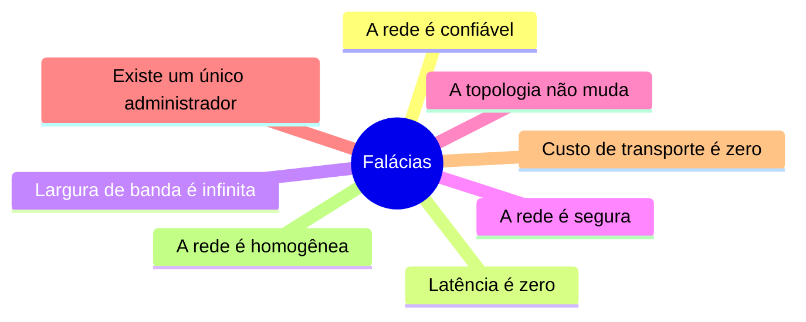
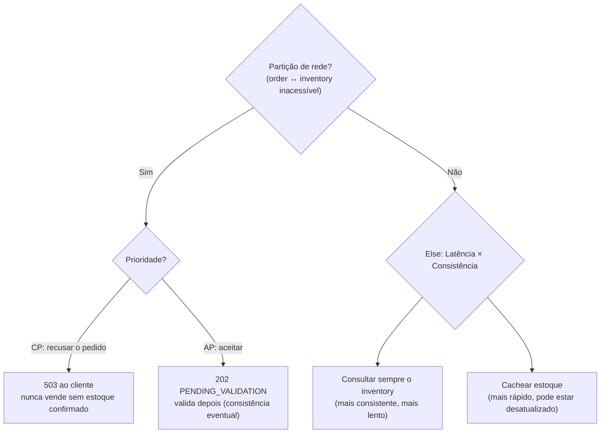
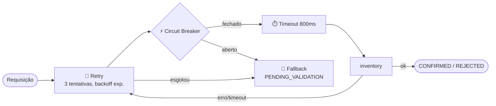
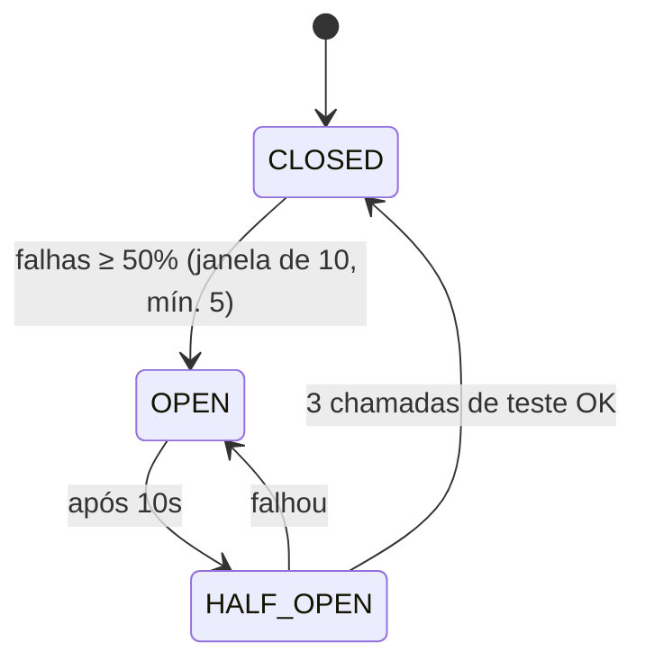
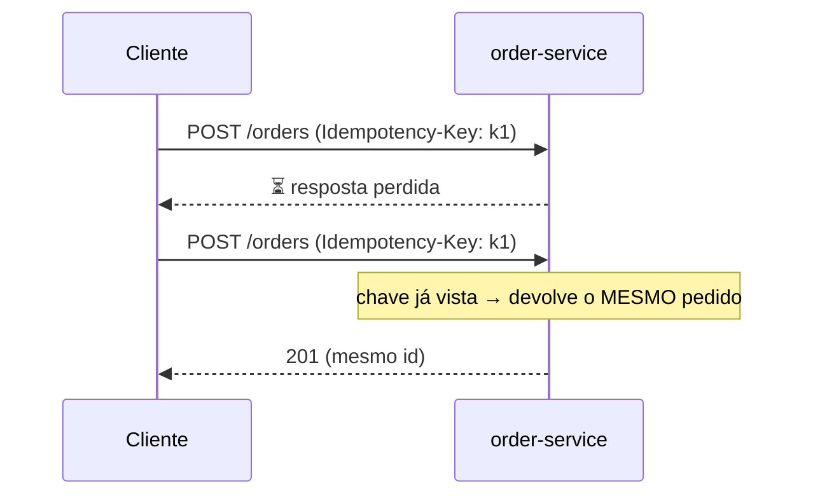
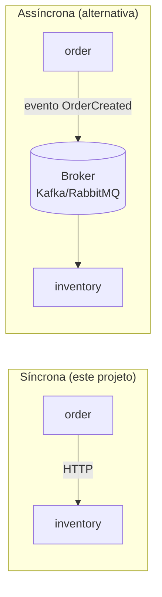
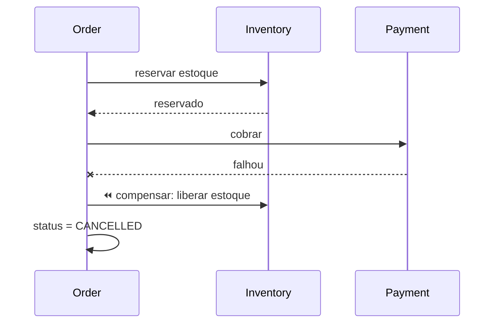

# ⚖️ Trade-offs em sistemas distribuídos

Em um sistema distribuído **a rede falha, tem latência e os nós caem**. Não existe design perfeito: existem escolhas conscientes.

## 1. As 8 falácias da computação distribuída

## 2. CAP e PACELC

Na presença de **P**artição de rede, escolha entre **C**onsistência e **A**vailability (disponibilidade).

**No projeto** (`OrderService` + `InventoryClient`): escolhemos **AP**. Se o inventory falha, o pedido é aceito como `PENDING_VALIDATION` (HTTP 202). Risco: *overselling* → exige compensação posterior (cancelar/pedir desculpas). Para pagamentos, a escolha típica seria CP.

## 3. Resiliência: timeout → retry → circuit breaker → fallback

| Mecanismo | Protege contra | Risco se mal configurado |
|---|---|---|
| Timeout | Dependência lenta que prende threads | Muito curto: falsos erros; muito longo: esgota threads |
| Retry + backoff | Falhas transitórias | **Tempestade de retries** amplifica a falha (3 camadas × 3 tentativas = 27 chamadas) |
| Circuit breaker | Falha em cascata; dá folga ao downstream | Limiares ruins abrem/fecham demais |
| Fallback | Degradação elegante | Resposta "falsa" precisa ser aceitável ao negócio |

**Experimente:** `POST localhost:8081/chaos?failurePercent=100` e depois `GET localhost:8080/actuator/circuitbreakers`.

## 4. Idempotência: obrigatória quando há retry

Um retry pode duplicar um efeito (o POST chegou, mas a resposta se perdeu).

> Limitação do exemplo: o mapa de chaves está em memória do pod. Com várias réplicas, deveria estar num armazenamento compartilhado (Redis/banco) com TTL.

## 5. Comunicação: síncrona vs. assíncrona

| | Síncrona (REST) | Assíncrona (eventos) |
|---|---|---|
| Acoplamento temporal | Alto (ambos precisam estar no ar) | Baixo |
| Simplicidade / debug | ✅ Simples | ❌ Mais difícil (ordem, duplicatas, DLQ) |
| Consistência | Imediata | Eventual |
| Latência percebida | Soma das chamadas | Resposta rápida, processamento depois |

## 6. Outros trade-offs que você vai encontrar

| Decisão | De um lado | Do outro |
|---|---|---|
| Monolito × microsserviços | Simplicidade, transações ACID | Deploy e escala independentes, mas rede, observabilidade e consistência distribuída |
| Transação distribuída | 2PC: forte, mas bloqueante e frágil | **Saga**: eventual, com compensações |
| Cache | Menor latência e carga | Dado obsoleto, invalidação difícil |
| Réplicas de leitura | Escala de leitura | *Replication lag* |
| Mais réplicas | Disponibilidade e vazão | Custo, mais conexões, mais coordenação |

## 7. Saga (evolução natural do exemplo)

## ✅ Checklist de decisão

1. Qual o custo de um dado inconsistente por alguns segundos? → define CP vs AP.
2. O que acontece se a dependência cair? → defina o fallback **antes** de ir para produção.
3. A operação é repetível sem efeitos colaterais? → idempotência.
4. Consigo ver o que acontece? → métricas, logs e traces antes de escalar.
